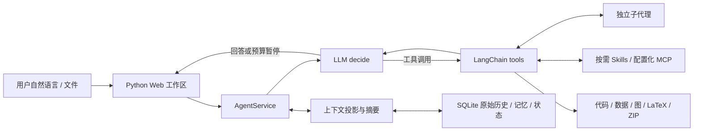

# PaperScientist 0.2 架构与设计依据

## 设计目标与入口

用户意图决定科研行动；阶段名称是项目数据，不能作为固定图的分支。`paperscientist/runtime.py` 的 LangGraph 只有 decide/tools 两个业务节点：LLM 可提问、回答、检索、调用技能、执行工具、委派子任务，直到回答或达到预算。`collector.py` 保留 notebook / LangGraph 入口，`web/app.py` 提供 FastAPI + Gradio。新增应用代码均为 Python，界面由 Python 组件生成。

`prompts.py` 限定科研诚实性、用户与文档指令边界、方向确认、证据引用、预算、技能与子代理使用条件。模型每轮看到最新项目状态和作用域内的记忆。正文中的指令不能变成用户授权；用户偏好的提炼要求找到真实用户消息中的原文引句。

## 阅读与参考范围

本次阅读了原 README、`PaperScientist_Documentation.pdf`（12 页）、原 collector/memory/Web、搜索、MCP/MySQL 工具，以及用户指定的两个本地参考目录。RL 学习和 RAG 资料作为既有资产保留，没有纳入默认运行依赖。

飞书原链接为 [PaperScientist 项目介绍](https://my.feishu.cn/wiki/PP9RwZxEHiJv5GkygrucWqffnQe)。本次 CLI 返回登录凭据过期，浏览器读取也未成功；因此没有宣称读到了当前在线版。Memory 依据包括本地已缓存的 `diagrams/2026-09-10T-memory-reference/page-1.txt` 至 `page-4.txt`，以及以下源码。Subagent 依据本地源码与提示词；在线“Subagent调度”小节的最新措辞尚未复核。

| 参考 | Python 适配 |
|---|---|
| copilot_marscode `ideagent/agentic/util/chat_memory.go`、core_memory prompt；缓存 Memory 说明 | `store.py` + `memory.py` 的六类存储（五类核心记忆及 experience）、作用域、版本与 sources |
| `process/extra/compact/v3_micro_compact.go`、`adaptive_micro_policy.go` | `context.micro_compact` 的 keep / clear / trim 投影 |
| `process/extra/compact/v3_compact.go` | `ContextManager.build` 的同步摘要、checkpoint、恢复包 |
| subagent context/registry、`spawn_agent.yaml`、`Agent.yaml` | `Scheduler` 的聚焦任务、角色、上下文选择、恢复与产物交接 |
| `skillpluginrender/gpt_skill_instructions.go` | `SkillCatalog` 的根目录别名、元数据列表、正文按需读取 |
| prompt-base 中偏好/项目知识提炼提示 | 原文证据要求、用户画像与项目约束的区分、文档/工具输出不作为偏好 |

原实现中的企业服务未复制：ContextGateway/ContextFS 的持久存储职责由 SQLite 与会话文件目录承担；Viking 检索由明确标注的本地词项重合检索替代。当前不是 Viking、向量索引或分布式服务的等价实现。没有导入参考仓库的凭据、内部端点或服务依赖。

## Memory 与原始历史

| 类型 | 所有者与生命周期 | 进入模型的方式 |
|---|---|---|
| user_profile | 用户，跨项目的研究兴趣、背景、协作偏好 | 自动注入最近有效版本；每项有用户原文证据 |
| project_memory | 用户 + 项目，约束、确认的决定、知识 | 自动注入；更正/删除产生新版本 |
| topics | 用户 + 项目 + 会话，每轮主题 | 自动注入同项目最近 7 天的最多 3 条 |
| session_memory | 同上，逐轮 intent/actions/outcome/learned/message_id/time | 按需 recall；不把全部会话总结自动塞回上下文 |
| automation_memory | 用户 + 显式 scheduled_task_id，run_count 与最近 10 次结果 | 只有调用方提供 task ID 才读写；普通对话不注入 |
| experience | 用户 + 项目，有来源的经验 | 本地词项检索，工具明确返回 retrieval 方法 |

`messages` 以 LangChain 消息格式追加存储，保留工具调用参数和结果；压缩不覆盖原始消息。`memories` 用 ID + version 保存修改与删除标记，sources 指向 session/message。Knowledge / Rule / Experience 是内容类别，不改变作用域。

默认每轮结束记录主题和结构化 session_memory；learned 保留为空，除非另有明确知识提炼，不凭空制造“经验”。可选 LLM 后处理提炼最多三条有直接用户证据的画像/项目记忆；提炼失败只记录 warning，不影响历史。`python -m paperscientist.refine` 提供离线历史提炼，默认 dry-run，最多处理最近 20 条用户消息，可显式 apply。它是 CLI 功能，没有隐式定时后台任务。

## 只有两类上下文压缩

1. **Micro compact**：达到有效预算的 55% 时尝试。最近实质用户回合及后续“继续”保留；之前三个回合压缩大工具结果；更早回合以完整组移除中间工具交换，保留用户与最终回答。调用/结果配对不被拆散。
2. **Sync summary**：micro 后超过有效预算的 80% 时同步总结旧回合。摘要包含目标、约束、方向状态、证据 ID、失败、开放问题、文件和待完成任务。分块总结的每次请求也有预算；只在结果缩小且可放入预算时写 checkpoint。

有效预算扣除了系统信息、工具 schemas 和输出预留。恢复包保存项目、技能、产物、子代理与记忆引用，后续请求继续加载。`read_history` / `read_tool_result` 可找回裁剪内容。单个当前任务过大时明确报错并保留原文，绝不静默丢弃用户输入。Token 数为估算，使用 cl100k_base，不能保证与所有供应商计数完全一致。

## Subagent

主代理拥有 spawn/list/wait/read/followup/send/cancel/import 工具。默认最多 3 个子任务运行，每个会话最多创建 24 个，空闲任务可复用。角色为 researcher、methodologist、engineer、analyst、writer、reviewer。任务名称在工具 schema 中校验。

子代理默认获得任务说明、项目和指定产物线索；可选 fork 加入有界父对话。子代理使用自己的历史、上下文预算和工作区；不能递归创建子代理或直接改画像/项目计划。父子通过登记的产物 ID 显式复制文件；父代理负责审查和汇总结果。

注册表持久化，运行任务与 mailbox 在进程内。重启把 running/queued 标为 interrupted，可 followup 继续；它不会声称进程重启后原协程仍在运行。消息事件会持久化，但未消费 mailbox 不会自动重放。取消保留原文与文件。达到子代理预算标记 interrupted，不能冒充 completed。

## 工具、MCP 与技能

本地工具均由 LangChain `@tool` / StructuredTool 生成 schema 并 `bind_tools`。普通工具调用按模型给定顺序执行，以保留写文件→执行→读取这类依赖；独立并发通过显式子任务实现。

检索保存论文元数据、获取时间及稳定 ID，引用检查只证明 ID 来自检索，不证明论文质量。外部网页拒绝内网 URL、逐跳验证重定向并限制下载尺寸；这不能替代部署级网络隔离。arXiv/Crossref/OpenAlex 接口分别解析并保留来源；OpenAlex 可通过 Authorization header 使用配置密钥，参见其[认证文档](https://help.openalex.org/api/authentication/)。

`mcp.json` 为服务端可信配置，支持 stdio 与 Streamable HTTP；`mcp_<server>_<tool>` 避免重名，嵌套 JSON Schema 保留并在执行前校验。允许列表可限制暴露工具；配置与凭据不会进入模型提示词。远端 MCP 自身的权限与执行能力需要由配置者控制；应用的本地 Python 开关不会替未知远端工具提供沙箱。

Skills 递归发现、来源命名空间、中英文查询与分页；启动提示仅列出本地技能和外部来源摘要。通过 load_skill 读取正文/资源，list_skill_resources 列举包内及 @source 共享资源，stage_skill 只复制文件。载入技能有独立恢复索引。内置 11 个包；视频推荐的 382 个外部包已按版本下载，来源与 hash 见 video-skills.lock.json。

独立审稿使用 spawn_agent 的 isolated_review 模式和显式 artifact_ids。调度器复制并校验评审包；system prompt 和 sync summary 恢复都排除父项目/记忆；禁用记忆检索、父产物随意读取和任意代码执行。普通 focused 子代理仍可继承项目状态，不能据此宣称盲审。评审包是上下文隔离机制，不能替代操作系统沙箱；父代理仍负责正确选择无评审结论的原始材料。

record_evidence 核对原文片段并保存来源 hash、主张和解释；audit_research 检查当前会话证据/实验与项目主张的结构对应、变更和缺口。文字解释是否成立仍需科学审查。plot_results 的 figure_contract.json 明确统计定义、数据 provenance 与报告缺口；draw_framework 同时保存可编辑 .drawio。

## 执行、实验与论文交付

Python 在独立子进程执行，过滤环境凭据，记录运行前脚本 hash、退出码、stdout/stderr、耗时、结果文件 hash。生成的常见数据、图表和源文件会自动登记。单文件自动登记上限 20MB；超大模型权重不自动摄入。执行权限是本地可信代码开关，不能抵御恶意 Python 读取宿主文件。

实验登记区分 measured、user_supplied、synthetic。measured 要求成功的 run_id 与该次运行捕获的结果 hash 匹配；这证明来源一致，不保证实验设计正确。用户上传结果须有上传来源。贡献—评估问题—数据—图—文字之间通过 claim_id、来源 hash、引用 ID 和计划记录建立联系。

固定 matplotlib 工具生成可重现脚本及 PNG/PDF/SVG；复杂排版可由模型写 Python。支持本地 CJK 字体回退。LaTeX 组装保存多文件工程与 BibTeX，validate_manuscript 检查丢失的图/章节/引用/label，compile_latex 返回实际编译状态，export_bundle 输出 ZIP。静态检查不能替代编译、视觉检查或学术审查。

## 保留与后续边界

原工作流保存在 legacy，新版不自动迁移或删除旧 MySQL 数据。旧聊天 JSON 有显式幂等导入。原有 RL/RAG 资料及用户未提交改动未作清理。

这是一套可运行、可扩展的本地科研协作实现。它未声称自动达到顶会录用水平，也未提供多租户认证、远端 GPU 调度、Viking 检索或常驻定时任务系统。那些能力可以通过明确的工具适配与后续验证扩展，不应以占位返回值伪装成已完成。
